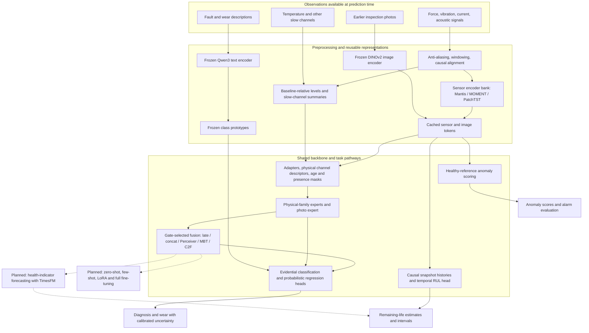

# Multimodal Predictive Maintenance

**From machine signals and inspection images to diagnosis, prognosis, and evidence.**

`pdmfm` explores how pretrained time-series, vision, and language encoders can support a
shared predictive-maintenance model across rotating machinery and milling. The research
combines physical sensor signals, occasional inspection photos, and text-defined fault
classes with small trainable experts, selective fusion, and calibrated uncertainty.

The ambition is a system that can recognize a fault, track degradation, detect unfamiliar
behavior from healthy examples, and explain which observations support its prediction, even
when a machine has only a subset of the sensors seen during training.

**Research status:** the source-training pipeline, fusion candidates, causal RUL models,
anomaly baselines, and public CPU demo are implemented. Final GPU experiments and target
adaptation remain ahead. This README describes the complete research design; the roadmap
below distinguishes working components from planned extensions. Foundation-model capacity
comes from inherited pretrained encoders; cross-asset transfer is a hypothesis to evaluate.

[Architecture](#architecture) | [Learning strategy](#learning-strategy) |
[Research roadmap](#research-roadmap) | [Datasets](#datasets-and-task-support) |
[Quick start](#quick-start) | [Documentation](#documentation)

## The research questions

Maintenance data arrive on different clocks: vibration changes within milliseconds,
wear accumulates over cuts, and an inspection photo may describe the previous operation.
Datasets also differ in sensors, machines, operating conditions, and label spaces. A useful
model must connect those observations while respecting what was available at prediction time.

The project investigates three questions:

1. **Representation:** can shared experts learn useful physical features across machines,
   while using whichever modalities each dataset actually supplies?
2. **Transfer:** can frozen representations and small adaptation modules reduce the labelled
   examples needed on another asset or damage distribution?
3. **Trust:** do calibrated uncertainty and faithful attributions help distinguish supported
   predictions, conflicting observations, and missing information?

| Task | Intended output |
| --- | --- |
| Diagnosis | Fault type, severity, or tool-wear class, with class evidence and calibrated probabilities |
| Wear estimation | Continuous flank wear with a predictive interval |
| Remaining useful life | A causal estimate of remaining life or an explicitly defined operating-life proxy |
| Healthy-only anomaly detection | Novelty scores, calibrated alarm thresholds, false-alarm measurements, and onset timing |

## Architecture

The design uses a frozen encoder bank to make expensive representations reusable, then
learns adapters, physical-family experts, and a compact fusion stage. Text provides a
semantic label space through fault descriptions. Operating-context sentences are retained
as metadata and excluded from predictive inputs because they can carry label shortcuts.

The diagram includes both the implemented core and the planned research branches.
Dashed branches mark future adaptation and forecasting work.



### Representation and fusion

| Layer | Design and purpose |
| --- | --- |
| Sensor inputs | Compare time segments, log spectra, and bearing-envelope order spectra. High-rate channels share a 12 kHz model rate and common 5 kHz band; milling inputs remain at 1 kHz. |
| Sensor encoder bank | Compare Mantis, MOMENT, and source-pretrained PatchTST. An AST waveform branch is available where the sampling rate supports it. Gate 1 selects encoder/input combinations using source validation data. |
| Physical descriptors | Baseline-relative level tokens restore degradation cues that per-input encoder normalization can remove. Slow channels use relative mean/slope summaries. |
| Inspection images | DINOv2 supplies photo tokens. Image kind, availability, and age distinguish tool, chip, workpiece, and insert observations. Milling predictions use photos available before the current pass starts. |
| Semantic labels | Qwen3 embeds fault-description paraphrases into frozen class prototypes. A learned projection maps sensor/image representations into that label space. |
| Shared experts | Experts share parameters by physical family across source datasets; datasets retain their own target heads and label spaces. Generic channel descriptors express sensor meaning without a dataset-ID input. |
| Fusion search | Plan B combines expert opinions through late evidential fusion. Concat, Perceiver, multimodal bottleneck transformer (MBT), and coarse-to-fine (C2F) candidates test whether interactions between modalities justify extra complexity. |
| Missing observations | Presence and token masks support incomplete modality sets. Robustness checks remove modalities and age inspection photos to measure dependence on each source of information. |
| Predictive uncertainty | Classification uses Dirichlet evidence; regression uses Normal-Inverse-Gamma heads and Student-t predictions. Validation-fitted calibration and empirical coverage assess their uncertainty. |

Per-modality opinions remain available alongside the combined prediction, exposing where
experts disagree. Evidential combination makes assumptions about correlated observations;
its usefulness is evaluated through calibration, conflict, robustness, and held-out scores.
A more complex fusion stage is selected only when it earns its place against the references.

### Learning strategy

Training builds on the encoder checkpoints through three complementary objectives:

- **Masked cross-modal modeling:** reconstruct hidden encoder features and descriptors
  from the observations that remain. Missing content cannot enter its own reconstruction.
- **Contrastive alignment:** bring paired views of the same observation together, using
  other physical units as negatives. Pairings include bearing-channel views,
  vibration/current, and milling force/earlier-photo observations where those pairs exist.
- **Supervised anchoring:** learn diagnosis, wear, and life-related targets on labelled
  source observations, with text prototypes anchoring the classification space.

The default combined objective is `L = L_mask + 0.5 L_contrastive + L_supervised`.
Unlabelled source observations can contribute to the self-supervised terms. Sampling
balances physical units and tempers the dominance of larger datasets.

One shared backbone is trained per outer fold, excluding that fold's validation and test
units. Gate 1 chooses the encoder/arms; Gate 2 tests fusion designs through inner grouped
validation. A shared winner must have usable inputs on every scored source task. Shared
pretraining merges source decisions conservatively, and fine-tuning retains the pretrained
backbone's actual architecture.

Planned ablations isolate masked modeling, contrastive alignment, supervised anchoring,
level descriptors, and modality availability. Transfer comparisons use matched support
sets so that improvements can be attributed to the learning method.

### Diagnosis, anomaly detection, and RUL

These tasks share data infrastructure and reusable representations while keeping their
supervision and evaluation protocols explicit.

**Diagnosis and wear** aggregate window predictions into recording/pass bags. This keeps a
long recording from becoming many independent labelled examples in the reported metrics.
Class evidence and continuous wear distributions support different outputs from the same
sensor/image pathways.

**Anomaly detection** learns a healthy reference and measures departure from it. Current
milling protocols use sharp training tools for support and healthy validation observations
to set a fixed threshold. The broader plan compares representation distances, reconstruction
scores, and conventional signal baselines. Photo anomaly maps and learned reconstruction
scores are future extensions. Reported alarms include false alarms and confirmation delay.

**RUL** uses causal histories of cached snapshot features, available earlier photos, and
elapsed-operation gaps. Milling estimates are made at pass end after observing the current
recording. The implemented temporal model estimates life from observations seen so far. The planned complementary arm forecasts a slow degradation indicator with
TimesFM and estimates time to a supported endpoint. Forecasting requires a defensible
endpoint and a useful health indicator; it does not create failure labels for a dataset.

### Transfer and explanations

The next research phase evaluates the shared backbone on assets and damage distributions
excluded from source fitting and model selection. Planned comparisons include zero-shot
text-prototype inference, few-shot linear probes, sensor-encoder LoRA, and full fine-tuning.
Adaptation recipes are to be chosen on source simulations before target evaluation.

The explanation pathway connects predictions to measurable evidence: frequency-band
occlusion, bearing-defect/order alignment where geometry is known, modality-removal tests,
and deletion/randomization checks. These components support the planned explanation cards:
a prediction, uncertainty, missing or stale inputs, expert disagreement, and supporting
attributions. Any optional language model would rephrase those computed findings.

## Research roadmap

| Phase | Deliverable | Current state |
| --- | --- | --- |
| Data foundation | Public-data ingestion, native readers, causal alignment, window stores, provenance and feature caches | Implemented; real-file acceptance remains open for Paderborn and PHM 2010 |
| Source model selection | Gate-1 encoder probes, Plan B, Gate-2 fusion search, grouped tuning | Implemented; complete GPU experiments pending |
| Shared source learning | Multi-task pretraining, fold-specific backbones, calibrated in-domain evaluation and paired reports | Implemented pipeline; final research results pending |
| Target transfer | Zero-shot and few-shot evaluation, sensor-encoder LoRA, full fine-tuning | Planned |
| Prognosis extensions | TimesFM health-indicator forecasting, expanded reconstruction anomaly scores, Nonastreda leave-one-tool-out comparison | Planned |
| Visual and decision evidence | Photo anomaly localization and complete explanation cards | Planned; band-occlusion and physics/faithfulness checks are implemented |
| Final study | Controlled ablations, held-out results, uncertainty analysis, compute ledger and reproducible report | In progress |

The broader design originates in the [archived proposal](docs/archive/PLAN-2026-10-23.md).
The [current plan](docs/PLAN.md) and subsequent audits define the active protocol, including
revised lifecycle labels, single-seed production runs, and the scope of supported claims.

## Datasets and task support

The corpus combines bearing and milling datasets with different modality sets. Paired
sensor/image fusion is demonstrated on milling; a thermal-only corpus does not establish
sensor/thermal fusion on the same machine.

| Dataset | Research role | Supported tasks and boundaries |
| --- | --- | --- |
| Nonastreda | Source; force with tool, chip and workpiece photos | Wear and healthy-reference novelty; life to a retrospectively confirmed dulled endpoint on an estimated operating clock |
| MATWI | Source; force, vibration, sound and insert photos | Pure-flank wear labels, novelty, and remaining recorded operating life |
| XJTU-SY | Source; bearing run-to-failure vibration | Causal bearing RUL and onset evaluation against derived first-prediction-time labels |
| CWRU | Source/probe; seeded bearing faults | Diagnosis and healthy-reference novelty; load-shift evaluation; no lifecycle RUL |
| Paderborn | Artificial-damage/source-healthy bearings for source learning; separate real-damage/healthy target bearings | Diagnosis and novelty; real-file acceptance pending; no run-to-failure RUL |
| KAIST | Target excluded from source fitting/search | Condition-shift diagnosis and novelty; historical labelled EDA is disclosed; device streams are asynchronous |
| PHM 2010 | Target for cutter-wear transfer | Cutter-disjoint wear estimation; real-file acceptance pending |

Optional research corpora include Najafi thermal images, NASA milling for sparse wear
regression, and MBHM subject to verified unit provenance. Their admission depends on what
the observations and metadata can support.

MATWI's current life target ends at the **last recorded operation**; it is an operating-life
proxy with unverified physical failure. Nonastreda's RUL lifecycle preserves all 512 logical
passes, while its historical wear view contains 378 distinct force recordings. Gap-clock
sensitivity, duplicate availability, missing wear labels, and censoring are explicit parts
of the protocol. See the [dataset audit](docs/DATASET_AUDIT.md) and
[EDA evidence](docs/eda/README.md).

## Evaluation and reproducibility

The study separates representation learning, selection, calibration, and testing:

- **Physical units define splits.** Five outer source folds hold out entire tools or
  bearings; four inner groups support model selection. CWRU/KAIST load splits measure
  condition shift. MATWI's material-mixed folds do not establish unseen-material transfer.
- **Production uses seed 0.** Five folds remain five groups of test units. Bootstrap
  intervals resample physical units and do not estimate training-seed variability.
- **Calibration has its own data.** Training fits normalizers; validation fits probability
  and interval calibration. Test scores do not choose operational alarm thresholds.
- **Baselines challenge shortcuts.** Comparisons include handcrafted features, linear
  probes, from-scratch models, late fusion, persistence, schedules, and lifetime baselines.
- **Coverage is reported.** Paderborn's five-fold protocol cannot place its three healthy
  source bearings in every test group. Class/bag coverage and pooled out-of-fold metrics
  accompany fold summaries.
- **Explanations face behavioral checks.** Removing attributed bands should change the
  prediction; randomized models provide a reference for physics-alignment claims.

Tests are divided into **unit**, **integration**, **end-to-end**, and explicit
**acceptance** suites. The default suite uses synthetic files and stand-in encoders;
real datasets, pretrained checkpoints, CUDA, and network access are checked separately.
Slow learning experiments are separate from routine CI. The
[test matrix](docs/TESTING.md) and [latest audit](docs/RUCHE_AUDIT.md) document validation
and outstanding checks.

## Quick start

Python 3.11 or 3.12. Run the public demo from a fresh checkout with no private repository,
external dataset, pretrained checkpoint, or GPU:

```bash
uv venv --python 3.11
uv pip install torch --index-url https://download.pytorch.org/whl/cpu
uv pip install -e ".[dev]"
uv run --no-sync python -m pdmfm.demo --out runs/demo
uv run --no-sync pytest
```

The demo creates small synthetic MAT/CSV inputs and stand-in image/text features, then
runs classification, RUL, and anomaly reporting on CPU. Outputs under `runs/demo` demonstrate
the pipeline; they are synthetic checks. Choose a fresh output directory for another run.

For real experiments, set `PDMFM_DATA_ROOT` and `HF_HOME` to directories outside the checkout.
Inspect downloads and dataset assumptions before preprocessing:

```bash
python -m pdmfm.fetch list
python -m pdmfm.fetch plan matwi
python -m pdmfm.lifecycle --dataset matwi
python -m pdmfm.lifecycle --dataset nonastreda --clock gap
```

Activate the environment before these commands, or prefix them with `uv run --no-sync`.
Install `.[encoders]` for pretrained encoding. MOMENT's dependency constraints may require
a separate extraction environment. The [Ruche runbook](docs/RUCHE_RUNBOOK.md) covers the
complete preprocessing, preflight, extraction, selection, training, and collection sequence.

## Compute design

Frozen features are cached once and reused across experiments. Raw window shards retain
float32 precision; feature banks can use float16 storage. Small trainable models support
automatic BF16 on compatible CUDA devices with FP32 evidential/likelihood math. Input staging,
resumable extraction, provenance checks, and training checkpoints reduce repeated work.

Ruche jobs isolate dataset/fold outputs and can pack independent cached-model fits onto a
GPU. Utilization logs and one-versus-two-worker pilots determine the useful packing level.
The **110 A100-hour ceiling** is an experiment budget; a measured GPU ledger is required.
Local CPU validation establishes no GPU speedup.

## Documentation

| Resource | Contents |
| --- | --- |
| [Current plan](docs/PLAN.md) | Active architecture, data contracts, evaluation and pending research |
| [Original proposal](docs/archive/PLAN-2026-10-23.md) | Broader architecture rationale and historical design choices |
| [Dataset audit](docs/DATASET_AUDIT.md) | Label provenance, lifecycle endpoints, supported tasks and unresolved access |
| [EDA guide](docs/eda/README.md) | Figures, summaries and the methodological decisions they motivated |
| [Testing guide](docs/TESTING.md) | Test categories, requirement coverage and acceptance commands |
| [Ruche runbook](docs/RUCHE_RUNBOOK.md) | Cluster setup, preflight, GPU pilots and isolated one-seed jobs |
| [Code audit](docs/AUDIT.md) / [Ruche follow-up](docs/RUCHE_AUDIT.md) | Confirmed fixes, validation evidence and remaining limits |
| [Progress log](PROJECT_LOG.md) / [CI guide](docs/CI.md) | Experiment history and automated checks |

## Repository layout

```text
pdmfm/       Dataset readers, preprocessing, encoders, models, learning and reports
configs/     Experiment configuration
scripts/     Development, CI and exploratory-data-analysis helpers
slurm/       CPU/GPU wrappers, isolated worker arrays and monitoring
tests/       Unit, integration, end-to-end and acceptance suites
docs/        Current specification, audits, dataset evidence and archived proposals
```

Code is released under the [MIT license](LICENSE). Datasets and pretrained checkpoints
retain their publishers' terms; the repository license does not license those assets.
