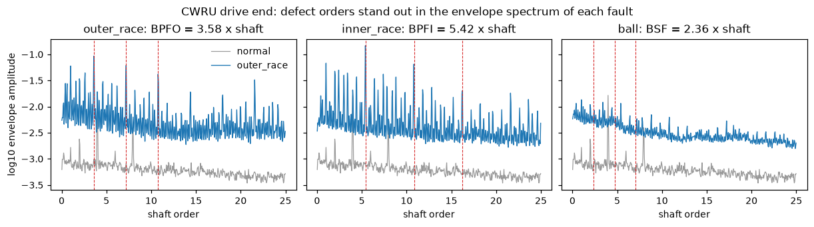
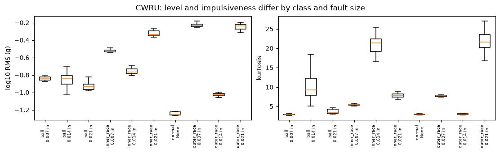
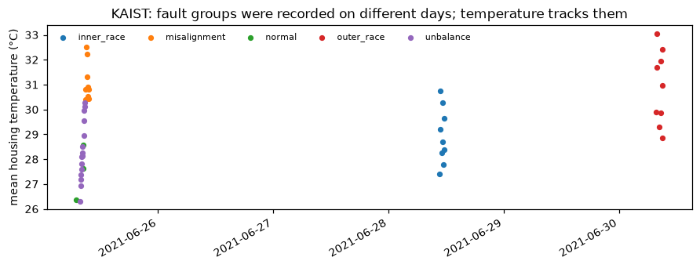
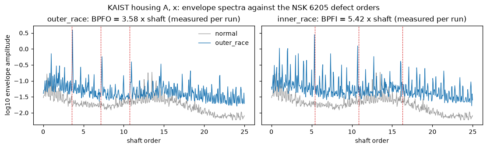
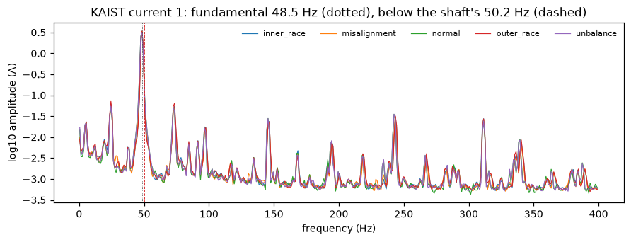
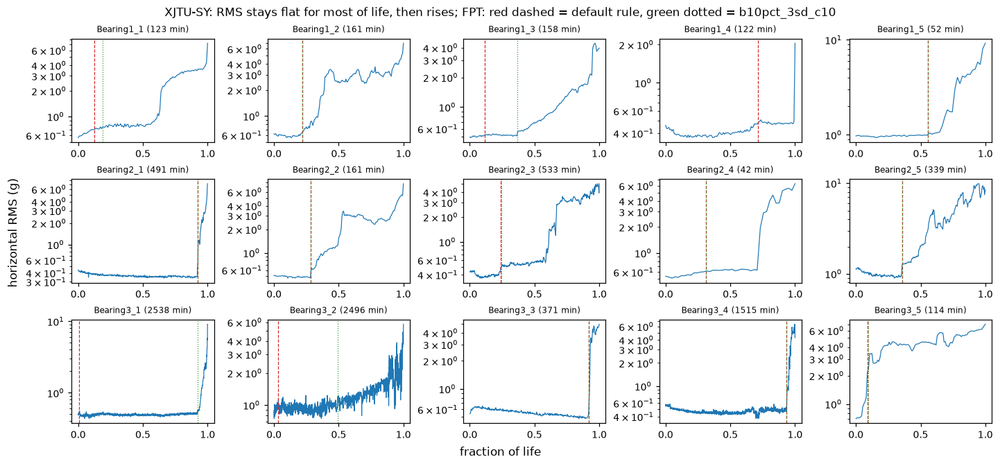
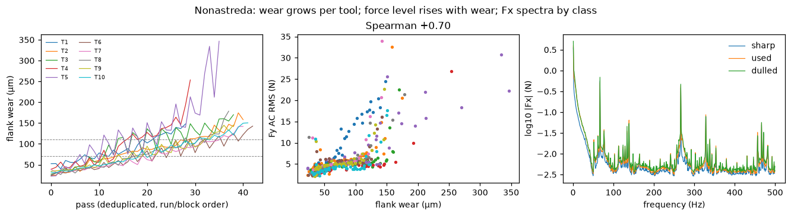
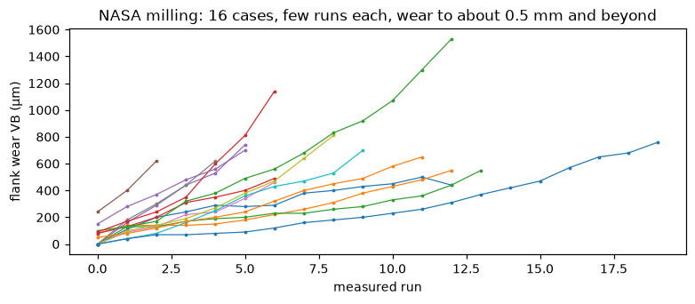
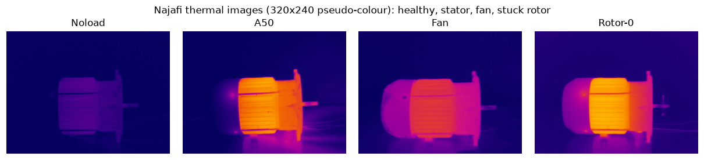

# Exploratory data analysis of the Project 14 datasets

*Data as downloaded in week 1 (2026-10-23 to 2026-10-26). Produced by
`scripts/eda/run_eda.py`; every number below is in `docs/eda/summary/<dataset>.json`, and
every figure in `docs/eda/figures/`.*

## 1. Purpose and scope

This report describes each dataset available locally. It records what the data imply for
preprocessing, splits, baselines and the shortcut risks the models must not exploit. The
analysis covers the seven datasets on disk:

- bearings: CWRU, KAIST, XJTU-SY, MBHM (metadata only);
- milling: Nonastreda, NASA milling;
- thermal motor images: Najafi.

Paderborn and PHM 2010 could not be downloaded from the development machine. Their readers
are written against the publishers' documentation, and acceptance tests will check them once
the files arrive (`docs/USER_ACTIONS.md`, steps 1-2).

**Reproduce.** `python scripts/eda/run_eda.py` (all datasets on disk), or name datasets
(`… kaist cwru`); `--quick` runs a subset and leaves `docs/` untouched. The script first
checks CPU and RAM (`pdmfm.resources`), refuses to start on a busy machine, and caps its
threads. A full run takes about 5 minutes on the development laptop (i7-11370H, 16 GB).
Every signal is analysed as the models will see it:

1. resampled to 12 kHz;
2. band-limited to 5 kHz (section 3.1);
3. cut into 12,288-sample windows (1.024 s).

**Conventions.** *Balanced accuracy* is the mean of per-class recall, so chance is 1/(number
of classes). *Handcrafted floor* means standardized logistic regression on 4 level descriptors
plus 16 log-spectrum bands per channel: the score any learned model must beat at Gate 1.
Section 10 defines every measure.

## 2. Findings at a glance

| # | Finding | Evidence | Consequence | Status |
|---|---|---|---|---|
| F1 | **CWRU recorder artifact.** Normal files (48 kHz source) keep content up to 6 kHz after resampling. The 12 kHz fault files lose about two decades above 5.25 kHz. That one band separates normal from fault perfectly | log10 ratio 5.7-6 kHz vs 4-5 kHz: normal −0.49 [−0.55, −0.42], fault −2.08 [−2.47, −1.03]; one-feature cross-load balanced accuracy 1.0 | Every source is band-limited to 5 kHz, and no log-domain feature is computed above 5 kHz | **Implemented** (`pp.band_limit`, `pp.model_input`, spectrum defaults) and tested |
| F2 | **KAIST recording sessions are confounded with class.** Normal, unbalance and misalignment were recorded on 25 June 2021, inner race on 28 June, outer race on 30 June | Reader timestamps (figure 4) | Anything that varies by session (temperature, sensor remounting, ambient) can stand in for the class. Splits never mix windows of one recording; the physics score acts as a guard | Documented; splits by condition |
| F3 | **KAIST temperature and recording-level constants are identifiers.** Temperature follows recording order; per-recording constants identify the recording | Spearman 0.60 between mean temperature and recording order; temperature alone is at chance across loads (balanced accuracy 0.13 for 15 classes, 0.20 for 5) | No absolute temperature input; at most the temperature rise within a recording | Recommended |
| F4 | **KAIST currents 2 and 3 are empty exactly in the 9 outer-race files** | Reader; regression test | A missing channel would identify the class. Only `current_1` is used | Implemented (reader) |
| F5 | **KAIST current fundamental (48.5 Hz) is below the shaft rate (50.17 Hz)**, which an induction motor cannot do. Explained if the electrical device's stated sample rate is about 3.4 % low | Welch peaks, per load: current 48.50 / 48.64 / 48.79 Hz; shaft 50.16 / 50.18 / 50.17 Hz | Never derive speed or slip from the current's absolute frequency axis. Express current spectra relative to their own measured fundamental | Open question; regression test |
| F6 | **Cross-load transfer on KAIST is hard, and only vibration transfers** | Handcrafted floor, 0/2 → 4 Nm: vibration 0.526 (15 classes) and 0.734 (5 types); current_1 at chance | A realistic target for Gate 1 and the transfer claims | Baseline recorded |
| F7 | **XJTU-SY: the default 3σ first-prediction-time rule fires falsely on long runs** (Bearing3_1 at 0.6 % of a 2,538-min life; its RMS is flat until about 92 %) | FPT sensitivity, 5 rules (table 7.2) | RUL labels use the 10 %-of-life baseline rule; Bearing1_4 (cage) needs a kurtosis fallback | Recommended; EDA support code in place |
| F8 | **XJTU-SY: outer-race failures show their line in the envelope, inner-race failures do not** | BPFO prominence rises in all 8 outer-race-only bearings (+0.11 to +1.21); BPFI shows no consistent change in the 3 inner-race-only bearings | The physics score on XJTU-SY is meaningful for outer-race failures only | Recommended |
| F9 | **Nonastreda: label persistence (78.8 %) beats the published accuracy (about 75 %)** | Share of consecutive passes with the same wear class | The persistence baseline goes into every Nonastreda table; the previous pass's photo can carry most of the signal | Recommended |
| F10 | **Nonastreda: Fz drifts by block** (−4.8 → −36.3 N), and its mean does not track wear (ρ = −0.04) | Block means | Fz is excluded or detrended by block; Fx and Fy are primary | Recommended (plan F3) |
| F11 | **Nonastreda: a 66.665 Hz line, constant to ±0.001 Hz in all 378 passes, with a 15-sample phase-locked pattern.** Consistent with a 4,000 rpm spindle and a 4-flute cutter (tooth passing 266.67 Hz), with tooth harmonics aliased by the 1 kHz sampling | Synchronous average 6.2 N peak to peak on Fx at period 15 vs 0.012 N at period 16; lines at 66.7, 133.3, 266.7, 466.7 Hz | Not a class shortcut (identical in all classes). Possibly aliased content above about 250 Hz. A milling physics score on Nonastreda becomes possible if the speed is confirmed | Inferred, unconfirmed |
| F12 | **Najafi thermal images are near-duplicates and trivially separable** | 95.7 % of images have their nearest neighbour in the same folder; raw-pixel classifier 1.0 under both random and block splits | Never evidence of generalization; image-pathway pretraining and label space only | As planned |
| F13 | **MBHM contains PU and XJTU**, which are our evaluation sets | Metadata | Drop the PU and XJTU subsets (114,864 windows remain) | Implemented (EDA count) |

## 3. Decisions for the shared preprocessing

### 3.1 One bandwidth for every source (new)

Recorders roll their anti-alias filters off at different points below Nyquist. At the 12 kHz
model rate, the band from 5.25 to 6 kHz therefore reveals the recording chain, not the machine.
In CWRU that chain is confounded with the class (F1). Profiles relative to 2-3 kHz, in
log10 amplitude:

| Source | 4.75-5 kHz | 5.25-5.5 kHz | 5.5-5.75 kHz | 5.75-6 kHz |
|---|---|---|---|---|
| CWRU normal (48 kHz, resampled) | −0.41 | −0.16 | −0.46 | −0.52 |
| CWRU faults (12 kHz native) | −0.63 | −0.80 | −1.41 | −2.85 |
| KAIST (25.6 kHz, resampled) | −0.41 | −0.40 | −0.42 | −0.42 |
| XJTU-SY (25.6 kHz, resampled) | −0.27 | +0.05 | +0.07 | +0.12 |

The CWRU fault files' roll-off starts above 5.25 kHz, so a common 5 kHz band keeps all fault
content. `pp.band_limit` is a linear-phase Kaiser FIR with no delay:

- flat to 5 kHz (gain within 0.1 %);
- at least 80 dB down from 5.25 kHz (243 taps at 12 kHz);
- its effect on the data: the power share above 5.25 kHz drops from 0.97 % (normal) and
  0.05 % (fault) to 1.9 × 10⁻¹¹ and 1.2 × 10⁻¹².

A log-domain feature is invariant to a common gain, though, so the ratio between classes
survives the filter. The protection therefore has two parts: the filter, and *no log-domain
feature above 5 kHz*. The second is now the default: the F-arm axis ends at 5 kHz (512
bands of 9.8 Hz), and the E-arm band is 1-5 kHz. `pp.model_input` applies resampling and then
the band limit, and it is the single entry point for every sensor arm.

### 3.2 Speed from the signal, not from metadata (new)

`pp.dominant_frequency` estimates a line's frequency: Welch PSD plus parabolic refinement,
with sub-bin accuracy (tested to 0.02 Hz with 0.125 Hz bins). Checked against the metadata:

- **CWRU:** the header RPM agrees with the vibration 1× line within 0.12 % in all 40 files,
  including the nominal fallback for files 98 and 99, which have no RPM.
- **KAIST:** the shaft runs at 50.17 Hz at every load, which is the nominal 3,010 rpm.

The E arm should use the measured speed per recording. This matters for Paderborn's
settings and for any dataset whose nominal speed is approximate.

### 3.3 Carried over from the plan, now supported by data

- **Level descriptors relative to a healthy baseline.** CWRU normal recordings are 0.2-1.0
  decades quieter than any fault (figure 2), and sensors differ across datasets. Absolute
  levels identify the dataset; relative levels carry the fault.
- **Order-normalized envelope (E arm).** Defect lines stand out where the physics says they
  should, in CWRU and KAIST (figures 1, 3; prominence in sections 5-6), and in XJTU-SY outer-race
  failures (F8).
- **Window length.** 1.024 s holds 51 KAIST shaft revolutions, 29-31 CWRU revolutions and
  36-41 XJTU-SY revolutions. The FFT resolution (0.98 Hz) is 0.02-0.03 orders at these
  speeds, finer than the E arm's 0.05-order bins.

## 4. Modalities and units per dataset

| Dataset | Physical units | Sensors (rate) | Images | Labels | Recordings → windows |
|---|---|---|---|---|---|
| CWRU | 1 bearing per fault type and size (10 units) | Drive-end and fan-end accelerometers (12 kHz faults, 48 kHz normal) | – | 10 classes (normal + 3 locations × 3 sizes) | 40 files → 356 windows |
| KAIST | 1 specimen per condition (15 units, each at 3 loads) | 4 accelerometers (25.6 kHz), 3 currents (25.6 kHz device), 2 temperatures, acoustic (51.2 kHz) | – | 15 conditions (5 types × severities) | 45 recordings → 4,378 windows |
| XJTU-SY | 15 bearings | 2 accelerometers (25.6 kHz, 1.28 s per minute) | – | RUL; failure location | 9,216 snapshots |
| Nonastreda | 10 tools | Fx, Fy, Fz (1 kHz) | Tool, chip and workpiece photos per pass | Wear class (3) and flank wear (µm) | 378 passes → 4,241 windows of 8 s |
| NASA milling | 16 cases | Spindle current (AC, DC), vibration and AE at table and spindle (250 Hz, RMS-processed) | – | Flank wear VB (µm) | 167 runs (146 with wear) |
| Najafi | 1 motor | – | 369 thermal images (320 × 240) | 4 classes, 11 conditions | 369 images |
| MBHM | none recorded | 9 public bearing sets, resampled to 24,000-point windows | – | Healthy, and 3 fault locations × 3 severities | 135,516 windows |

## 5. CWRU (Case Western Reserve University bearing data)

**Inventory.**
- 40 files: normal ×4, then inner race, ball and outer race ×12 each.
- Each fault is seeded in three sizes (0.007, 0.014 and 0.021 in), and each is recorded at loads of 0-3 hp.
- Durations are 10.1-10.2 s, except file 97 at 5.08 s, giving 356 windows in total.
- File `99.mat` also contains a copy of file 98's variables (`X098_*`); the reader uses only the file's own variables.

**Speed.** The header RPM ranges from 1,796-1,797 at 0 hp to 1,721-1,729 at 3 hp. The
vibration-derived speed agrees within 0.12 % in every file (§3.2).

**Envelope spectra (figure 1).**

| Fault | Defect order | Line prominence, fault | Line prominence, normal |
|---|---|---|---|
| Outer race | BPFO = 3.585 | 0.380 | 0.049 |
| Inner race | BPFI = 5.415 | 0.230 | 0.000 |
| Ball | BSF = 2.357 | 0.183 | 0.080 |

Ball faults are the least visible, as the CWRU literature reports.

*Figure 1. Mean envelope order spectra (drive end), fault vs normal; dashed lines at 1-3 × the defect order.*

**Levels (figure 2).**
- Every fault is louder than normal.
- Severity is **not monotonic** in level or kurtosis:
  - the 0.014 in outer-race fault is the quietest outer-race fault;
  - the 0.014 in ball fault has the highest kurtosis of the ball faults.
- So fault size must be a category on CWRU, never an ordinal target.

*Figure 2. log10 RMS and kurtosis per class and fault size.*

**Baselines and shortcuts.**
- **Handcrafted floor:** 1.0 balanced accuracy and 1.0 macro-F1 under the cross-load split
  (train 0-2 hp, test 3 hp, 10 classes). The train and test windows come from the same physical
  bearing at another load, so this measures condition shift on the same units.
- **Recorder artifact (F1):** the 5.7-6 kHz band separates normal from fault perfectly.
- **Electrical lines:** a 360 Hz line (6 × 60 Hz) appears in all four normal files at every
  load, even though shaft speed changes. It is electrical, and marks a 60 Hz grid; most other
  sources are on 50 Hz grids.
- **Drive end vs fan end:** the RMS of the two sensors correlates with a median of 0.67 within
  recordings.

**Role.** Use for pretraining and as a sanity check only. Its scores carry no weight as
evidence (decision C in `docs/USER_ACTIONS.md`).

## 6. KAIST (rotating machine with vibration, current, temperature, acoustic)

**Inventory.**
- 45 recordings: 15 conditions × loads of 0, 2 and 4 Nm.
- Conditions: normal; inner and outer race (0.3, 1.0, 3.0 mm); misalignment (0.1, 0.3, 0.5 mm);
  unbalance (583-3,318 mg).
- Durations: 60 s (bearing faults, 18 recordings), 120 s (misalignment, unbalance and normal at 2 and
  4 Nm; 26 recordings), 300 s (normal at 0 Nm).
- Windows: 1,576 at 0 Nm, 1,401 at 2 Nm, 1,401 at 4 Nm.
- The 2 Nm unbalance folders are spelled `Unbalalnce`; the reader normalizes the name.

**Two devices, two clocks.**
- The vibration device and the current/temperature device start 3.3-3.5 min apart in 40 recordings.
- In five recordings they are 23-30 min apart: 0Nm_BPFI_03 (−29.9 min), 0Nm_BPFI_10 (+23.3), and
  BPFO_03 at every load (+28.4 to +28.5). Those were recorded at different times.
- Vibration and current are therefore pairs describing the same machine state, not synchronous
  samples. Cross-modal objectives must not assume sample alignment.

**Recording sessions (F2, figure 4).**

| Day | Classes recorded |
|---|---|
| 2021-06-25 | normal, unbalance, misalignment |
| 2021-06-28 | inner race |
| 2021-06-30 | outer race |

Temperature rises through each session: normal at 0 Nm was recorded first, at 26.3-26.5 °C,
and outer-race runs reach 28-33 °C.

*Figure 4. Mean housing temperature against recording time, coloured by class.*

**Envelope spectra (figure 3).** Taken from housing A, x axis, on the measured shaft order axis:

| Fault | Line prominence, fault | Line prominence, normal |
|---|---|---|
| Outer race | 0.226 | 0.056 |
| Inner race | 0.268 | 0.100 |

The BPFO line at 3.58 orders is the strongest line in the outer-race spectrum.

*Figure 3. Envelope order spectra (housing A, x) against the NSK 6205 defect orders.*

**Motor current (F5, figure 5).**
- The fundamental is at 48.5 Hz in every normal recording.
- Its spectrum carries lines at 24.3, 72.8, 97 and 145.5 Hz, and the classes overlap almost
  completely in their means.
- Across loads, the per-load median fundamental rises from 48.50 to 48.79 Hz while the shaft stays
  at 50.17 Hz. A two-pole induction motor's field must turn faster than its rotor.
- If the electrical device's stated rate were about 3.4 % low, the true fundamental would be
  50.17-50.47 Hz. That means zero slip at no load and slip growing with torque, which is
  physically consistent.

*Figure 5. Mean spectrum of current 1 by class; dotted: measured fundamental; dashed: measured shaft rate.*

**Cross-load handcrafted floors (train 0 and 2 Nm, test 4 Nm).**

| Features | 15 conditions (chance 0.067) | 5 fault types (chance 0.20) |
|---|---|---|
| Vibration (4 accelerometers) | 0.526 | 0.734 |
| Current 1 | 0.067 | 0.210 |
| Temperature (recording means) | 0.133 | 0.200 |
| All | 0.532 | 0.693 |

Before the common band limit (§3.1), "all" scored 0.337 on 15 classes: the current channel's
content above 5 kHz hurt transfer. Current and temperature, in handcrafted form, carry no
information that transfers across loads. Temperature is constant within a recording, so
under a window-level random split it would identify the recording perfectly (F3).

**Consequences.**
- Split by condition and load; never by windows within a recording.
- No absolute temperature input.
- Use `current_1` only.
- Express current spectra relative to their own fundamental.
- State that the cross-load test is a condition shift on the same specimens.

## 7. XJTU-SY (run-to-failure bearings)

### 7.1 Inventory and trajectories

- 15 bearings at 3 conditions, 9,216 one-minute snapshots, each 32,768 samples at 25.6 kHz
  (1.28 s).
- Lifetimes in minutes, matching the paper:

  | Condition | Lifetimes (min) |
  |---|---|
  | 35 Hz, 12 kN | 123, 161, 158, 122, 52 |
  | 37.5 Hz, 11 kN | 491, 161, 533, 42, 339 |
  | 40 Hz, 10 kN | 2,538, 2,496, 371, 1,515, 114 |

- Horizontal RMS grows 4.4-17.9 × from the first to the last snapshot. Most bearings stay flat
  for most of their life, then rise in steps (figure 6).
- Bearing1_4, a cage failure, stays flat until a final spike: last-snapshot kurtosis 144.

*Figure 6. Horizontal RMS over the fraction of life; red dashed: default FPT rule; green dotted: the recommended rule.*

### 7.2 First prediction time (F7)

Share of life before the FPT, for five rules: baseline length, σ, and consecutive exceedances.
"10 %" means 10 % of life, with at least 10 snapshots.

| Bearing (life, failure) | 10, 3σ, 3 (default) | 10, 3σ, 10 | 30, 3σ, 10 | 30, 4σ, 30 | **10 %, 3σ, 10** |
|---|---|---|---|---|---|
| 1_1 (123, outer) | 0.122 | 0.122 | 0.585 | 0.602 | **0.187** |
| 1_2 (161, outer) | 0.217 | 0.217 | 0.217 | 0.224 | **0.217** |
| 1_3 (158, outer) | 0.114 | 0.171 | 0.367 | 0.373 | **0.367** |
| 1_4 (122, cage) | 0.713 | none | 0.697 | none | **none** |
| 1_5 (52, inner + outer) | 0.558 | 0.558 | 0.596 | none | **0.558** |
| 2_1 (491, inner) | 0.921 | 0.921 | 0.921 | 0.921 | **0.921** |
| 2_2 (161, outer) | 0.286 | 0.286 | 0.286 | 0.286 | **0.286** |
| 2_3 (533, cage) | 0.238 | 0.238 | 0.238 | 0.291 | **0.244** |
| 2_4 (42, outer) | 0.310 | 0.310 | 0.714 | none | **0.310** |
| 2_5 (339, outer) | 0.357 | 0.357 | 0.357 | 0.383 | **0.357** |
| 3_1 (2,538, outer) | **0.006** | **0.006** | 0.935 | 0.937 | **0.924** |
| 3_2 (2,496, mixed) | **0.033** | 0.067 | 0.492 | 0.660 | **0.493** |
| 3_3 (371, inner) | 0.919 | 0.919 | 0.919 | 0.919 | **0.919** |
| 3_4 (1,515, inner) | 0.935 | 0.935 | 0.935 | 0.935 | **0.935** |
| 3_5 (114, outer) | 0.088 | 0.088 | none | none | **0.096** |

- **Default rule:** fires within the first 5 % of life on the two longest runs. Ten snapshots
  of a 2,500-minute run are too few to estimate the healthy spread.
- **Fixed 30-snapshot baseline:** cures that, but on short runs it swallows the onset: it misses
  Bearing3_5 (114 min) and moves Bearing2_4 from 0.31 to 0.71.
- **10 %-of-life baseline:** no early alarms, an onset in 14 of 15 bearings, and agreement with
  visual onsets in figure 6. It needs the lifetime, which is acceptable because it only
  *labels* the data offline; models never see the FPT.
- **Recommendation:** use the 10 %-of-life rule for RUL labels, with a kurtosis-based fallback
  for abrupt failures such as Bearing1_4. Report the sensitivity of RUL metrics to the rule.

### 7.3 Envelope lines at end of life (F8)

Change in line prominence between the first and last snapshot:

| Failure | Bearings | Change at the matching line |
|---|---|---|
| Outer race only | 1_1, 1_2, 1_3, 2_2, 2_4, 2_5, 3_1, 3_5 | BPFO: +0.77, +0.75, +0.22, +1.21, +0.11, +0.58, +0.76, +0.34 (all positive) |
| Inner race only | 2_1, 3_3, 3_4 | BPFI: −0.05, −0.03, +0.11 (no consistent change) |

Inner-race lines are modulated by the shaft and spread into sidebands, and the fixed 1-5 kHz
band may miss their resonance. The physics alignment score on XJTU-SY is therefore defined for
outer-race failures only, unless a sideband-aware variant is added.

## 8. Milling

### 8.1 Nonastreda (force + photos)

**Inventory.**
- 378 deduplicated passes from 10 tools: sharp 147, used 118, dulled 113.
- Passes last 50-149 s (median 96.9 s), giving 4,241 windows of 8 s at 1 kHz.
- ADC step: 0.153 N for Fx and Fy, 0.305 N for Fz. Fz takes only 54-134 distinct values per pass.

**Force against wear** (Spearman over passes):

| Feature | ρ with flank wear |
|---|---|
| Fx mean | +0.68 |
| Fy mean | −0.68 |
| Fz mean | −0.04 |
| Fx AC RMS | +0.44 |
| Fy AC RMS | +0.70 |
| Fz AC RMS | +0.42 |
| Tool-photo mean grey level | −0.05 |
| Tool-photo grey-level spread | −0.15 |

- Raw photo statistics carry no wear information, so the image pathway needs learned features.
- Dividing each tool's levels by its first pass *lowers* the correlation (Fy RMS 0.70 → 0.52,
  Fx 0.44 → 0.40). Tool-to-tool level differences are partly wear-related, so keep absolute
  levels, with relative levels as an ablation.

*Figure 7. Wear per tool over passes (dashed: class thresholds 71 and 110 µm); Fy AC RMS against wear; mean Fx spectrum per class.*

**Baselines.**
- **Persistence:** the wear class repeats from one pass to the next in 78.8 % of transitions
  (F9). Predicting "same class as the previous pass" therefore scores about 79 % if the previous
  label is known. The dataset authors' roughly 75 % leave-one-tool-out accuracy is below that.
  A model given the previous pass's photo can recover the previous state, so every Nonastreda
  table must report this baseline.
- **Handcrafted floor (leave one tool out, 10 folds):** per-pass Fx and Fy levels give a balanced
  accuracy of 0.566 (chance 0.333). Fz is left out because of its block drift.

**Fz drift (F10).** Mean Fz by block: −4.8 N (block 1), −13.7 (2), −32.3 (3), −36.3 N (4). It
follows the run order, not wear.

**The 66.665 Hz line (F11).**
- The strongest Fx line sits at 66.664-66.666 Hz in all 378 passes, with lines at 133.3, 266.7,
  328/338 and 466.7 Hz. The line family is identical in every class and tool.
- 66.667 Hz is exactly a fifteenth of the sampling rate. Folding each pass at 15 samples gives
  a smooth sinusoidal pattern, with medians of 6.2 N (Fx), 3.5 N (Fy) and 1.7 N (Fz) peak to
  peak. A 16-sample control gives 0.01 N.
- **Not sample duplication:** exact repeats of a sample are spread evenly across the 15 phases
  and are explained by the ADC step.
- **Most consistent explanation:** a spindle at exactly 4,000 rpm (66.67 Hz), with runout at 1×
  and tooth passing at 266.67 Hz for a 4-flute cutter. Tooth harmonics above 500 Hz alias back
  into the band (533.3 → 466.7 Hz), which implies no anti-alias filtering before the 1 kHz
  sampling.
- **Unconfirmed:** the dataset does not publish spindle speed or tooth count.
- **Consequences:**
  - the line is not a shortcut;
  - spectral content above about 250 Hz may be aliased;
  - a tooth-passing physics score for Nonastreda needs the speed confirmed from the
    Nonastreda paper or its authors.

### 8.2 NASA milling (fallback for PHM 2010)

**Inventory.**
- 167 runs in 16 cases; 146 runs have a flank-wear value, ranging 0-1,530 µm.
- Each case has only a few measured runs (figure 8).

**Signals against wear** (Spearman, per-run means):

| Signal | ρ with wear |
|---|---|
| Spindle current, DC | +0.79 |
| Spindle current, AC | +0.59 |
| AE, table | +0.67 |
| AE, spindle | +0.58 |
| Vibration, table | −0.22 |
| Vibration, spindle | −0.55 |

The signals are RMS-processed at 250 Hz, so the dataset suits level-based wear regression,
not spectral or physics analysis. If it replaces PHM 2010, split by case.

*Figure 8. Flank wear over measured runs, one line per case.*

## 9. Images and pretraining corpus

### 9.1 Najafi thermal motor images (F12)

**Inventory.**
- 369 pseudo-colour thermal images (320 × 240) in 11 condition folders.
- Classes: stator short circuit 286 (8 folders by phases and percentage), stuck rotor 30,
  cooling fan 28, healthy 25.

**Near-duplicates.**
- 95.7 % of images have their nearest neighbour in the same folder.
- Median RMS distance to that neighbour: 0.010 within a folder, against 0.057 to the nearest
  image in another folder.
- Only 52 % of those neighbours are within two files, so the folders are not simple frame
  sequences.

**Separability.**
- A raw-pixel logistic regression reaches 1.0 balanced accuracy under a random 70/30 split.
- It reaches 1.0 when the last 30 % of each folder is held out.

The task is trivial and the classes are imbalanced (77.5 % stator). Najafi feeds the
image-pathway pretraining and the text-anchored label space only, and no accuracy on it is
reported as evidence.

*Figure 9. One image per class: healthy (Noload), stator (A50), fan, stuck rotor.*

### 9.2 MBHM (resampled public bearing corpus)

- 135,516 windows of 24,000 points from nine source datasets; per dataset and label in
  `docs/eda/summary/mbhm.json`.
- The metadata carries no bearing or unit identifiers.
- It includes PU (Paderborn, 7,316 windows) and XJTU (13,336), both evaluation sets here, so
  both are dropped, leaving 114,864 windows.
- The corpus is dominated by IMS (46,480, of which 43,176 are healthy) and JUST (43,986), so
  pretraining must sample datasets ∝ n^0.5, as planned.

## 10. Shortcut register

| Shortcut | Datasets | Mechanism | Guard |
|---|---|---|---|
| Recorder roll-off | CWRU (class), all (dataset identity) | Different anti-alias filters | 5 kHz common band; no log features above it (§3.1) |
| Mains lines | CWRU 60 Hz grid; others near 50 Hz | Electrical interference at fixed Hz | Order-normalized E arm; check F-arm attributions against mains harmonics |
| Absolute level | All | Sensor sensitivity, mounting | Levels relative to a healthy baseline per unit |
| Recording session | KAIST (days = class groups), Nonastreda (blocks), XJTU-SY (condition) | Ambient, remounting, drift | Splits by unit or condition; physics score as a check |
| Recording-level constants | KAIST temperature, device offset | Identify the recording | Never split windows of one recording |
| Class-dependent missing channel | KAIST currents 2-3 (outer race) | Absence identifies the class | Excluded in the reader |
| Label persistence | Nonastreda (78.8 %) | Previous-pass photo reveals the previous state | Persistence baseline in every table |
| Near-duplicate images | Najafi | Same scene, small changes | Not used as evidence |
| Overlap with evaluation data | MBHM (PU, XJTU) | Same recordings | Excluded |

## 11. Open questions

1. **KAIST current:** is the electrical device's true sample rate about 3.4 % above its
   stated `wf_increment`? Check the KAIST paper and DAQ settings, or ask the authors.
2. **Nonastreda spindle speed and tooth count:** do they match the inferred 4,000 rpm and
   4 flutes? Check the Nonastreda paper or ask the authors.
3. **Inner-race visibility on XJTU-SY:** does a sideband-aware or resonance-adaptive band (for
   example a kurtogram-selected band) recover the BPFI lines?
4. **Paderborn and PHM 2010:** the acceptance tests (`tests/test_real_data.py`) settle their
   layouts, rates and, for PHM 2010, the spindle speed.

## 12. Definitions

- **Line prominence:** the mean log10 envelope amplitude within ±2 % of the given orders
  (1-3 × the defect order), minus the spectrum's median. Zero means no line.
- **Top-band ratio:** the mean log10 amplitude in 5.7-6 kHz minus that in 4-5 kHz, on
  resampled but not band-limited windows.
- **Power share above 5.25 kHz:** the fraction of a window's Hann-tapered power above 5.25 kHz.
- **First prediction time:** the first of *c* consecutive snapshots whose RMS exceeds the mean +
  *k*σ of the first *b* snapshots (`pp.first_prediction_time`).
- **Synchronous average at period P:** the signal reshaped into rows of *P* samples and averaged
  over rows. A component locked to *P* samples survives; everything else averages out.
- **Handcrafted floor:** standardized logistic regression (C = 1) on per-window level
  descriptors (log RMS, log peak, kurtosis, crest) and 16 equal log-spectrum bands per channel.
  Balanced accuracy and macro-F1 on the held-out split.

**Tests behind this report.**
- `tests/test_eda.py`: helpers, and end-to-end runs on synthetic CWRU and Najafi files.
- `tests/test_preprocess.py`: band limit, dominant frequency.
- `tests/test_real_data.py`: the CWRU roll-off and KAIST current findings as regression tests,
  and the acceptance tests for Paderborn and PHM 2010.
